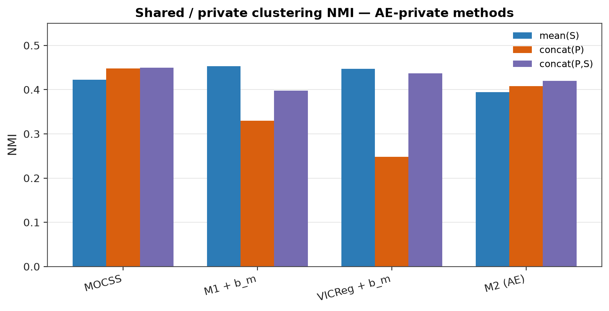
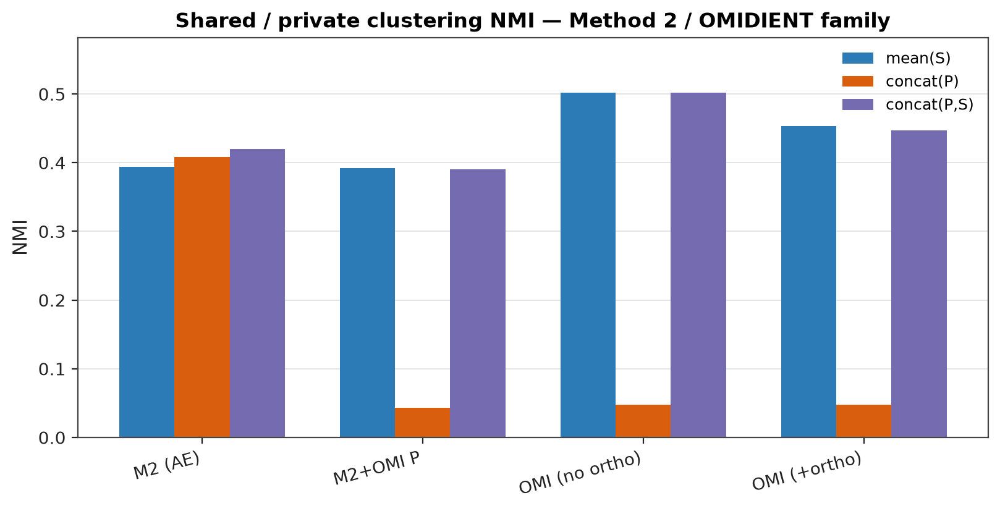
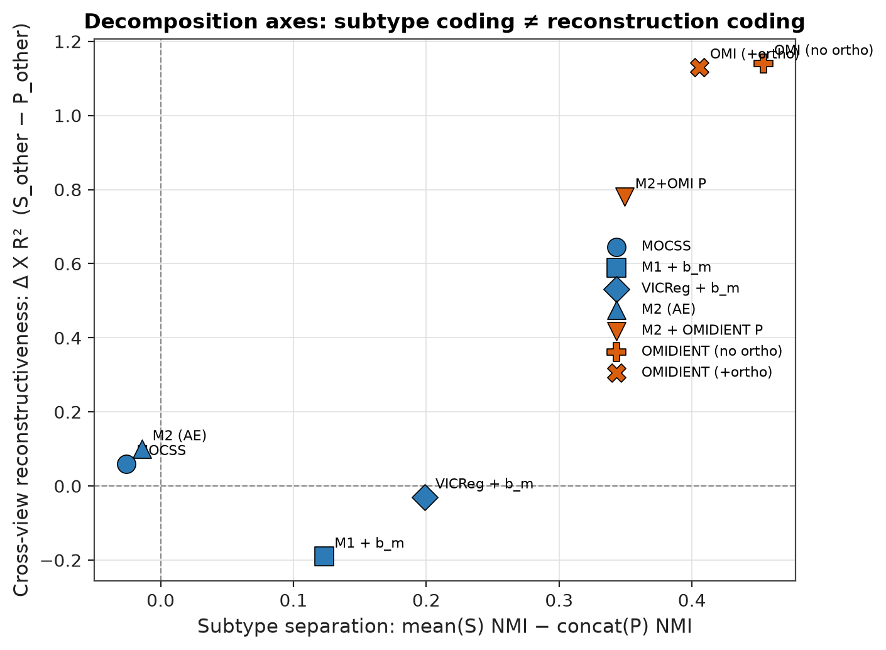
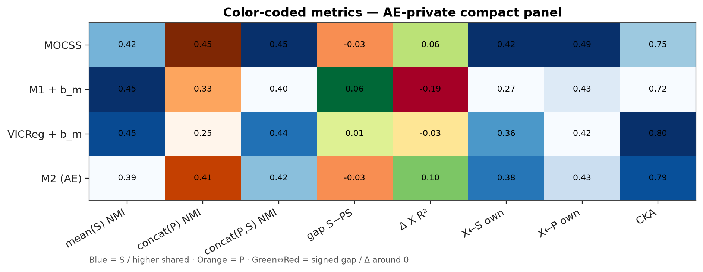
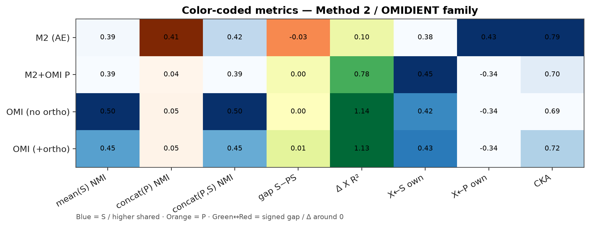
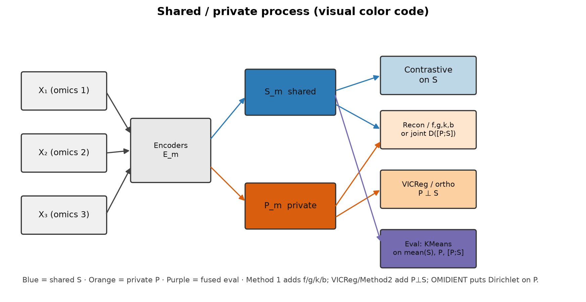

# Shared Representation Training Results

Training and evaluation results for the methods described in [`shared-representation-method.md`](./shared-representation-method.md). Metrics are reported on the BRCA multi-omics setting used in this repository.

**Private branch (important):** Method 1, Method 1 VICReg ablation, and Method 2 (AE private) use a **MOCSS-style plain AE** for `P_m`. Fair AE-private comparisons are vs **MOCSS (AE)**. **OMIDIENT** uses product-Dirichlet private + MOCSS-style shared. In this repo the published checkpoint `0.0003_0.0005_4` was trained **without** `L_ortho` in `loss_total` (implementation gap); that row is labeled **OMIDIENT (reported / no \(L_\mathrm{ortho}\))**. **OMIDIENT (with \(L_\mathrm{ortho}\))** is the intended objective (λ-sweep below). **Method 2 + OMIDIENT private** mixes Method-2 shared with Dirichlet private — see the separate family table.

**Ranking:** configs are ranked by **core validation loss** (MOCSS-style; label-free). Method 1 / Method 1 VICReg → `L_std + L_shared + L_priv + L_ctr` (with `b_m`; `L_vic` excluded for VICReg). Method 2 / Method 2+OMIDIENT → `L_recon + L_ctr` (`L_vic` / `L_kl` excluded). OMIDIENT with \(L_\mathrm{ortho}\) λ-sweep → `L_ctr + L_recon + KL` (λ and `L_ortho` excluded from ranking). Clustering/kNN/shared probes are reported on the selected config (KMeans `n_init=30`).

**`b_m(P_m) → X_m` (private sufficiency):** Method 1 and Method 1 VICReg numbers below are **with** `b_m` and `λ_priv` (`p` token in config names).

**Shared-quality metrics** (implemented in `code/shared_rep_metrics.py`):

1. Clustering + kNN on `mean(S)` (`s_nmi`, `s_knn_acc`, …)
2. Cross-view probes: subtype ← `S_other`; Ridge R² for `X_A ← (S_B,S_C)` vs `X_A ← (P_B,P_C)`
3. Own-view reconstructiveness: Ridge R² for `X_m ← S_m`, `X_m ← P_m`, `X_m ← [P_m;S_m]` (mean over modalities)
4. Alignment of shared codes: mean pairwise cosine / CCA / linear CKA

Config name prefixes like `0.0004_0.0007` are learning-rate / weight-decay settings; the remaining tokens encode loss weights (`a`/`b`/`g` = α/β/γ, `p` = λ_priv, `l` = λ_ctr, `v` = λ_vic, `r`/`c` = λ_rec / λ_ctr for Method 2; OMIDIENT ortho: `c`/`r`/`k`/`o` = λ_ctr / λ_recon / λ_kl / λ_ortho).

---

## Figures (visual color code)

**Color language (same in every plot):** blue = shared \(S\); orange = private \(P\); purple/gray = concat \([P;S]\); green↔red = signed gaps / \(\Delta\) around 0.

| # | File | What it shows | Needs checkpoints? |
| - | ---- | ------------- | ------------------ |
| 1 | [`figures/01_nmi_bars_ae.png`](./figures/01_nmi_bars_ae.png), [`01_nmi_bars_omidient.png`](./figures/01_nmi_bars_omidient.png) | mean(S) / concat(P) / concat(P,S) NMI bars | No (README numbers) |
| 2 | [`figures/02_scatter_separation_vs_delta_xr2.png`](./figures/02_scatter_separation_vs_delta_xr2.png) | subtype separation vs \(\Delta\) X R² | No |
| 3 | [`figures/03_metric_heatmap_ae.png`](./figures/03_metric_heatmap_ae.png), [`03_metric_heatmap_omidient.png`](./figures/03_metric_heatmap_omidient.png) | color-coded compact metrics | No |
| 4 | [`figures/04_method_schematic.png`](./figures/04_method_schematic.png) | process schematic (\(S\)/\(P\)/losses) | No |
| 5 | [`figures/05_embedding_umap.png`](./figures/05_embedding_umap.png) (or `…_tsne`) | UMAP/t-SNE of mean(S) vs concat(P), colored by subtype | Yes (existing models) |
| 6 | [`figures/06_sweep_*.png`](./figures/) | hyperparameter heatmaps from leaderboard CSVs | Yes (existing CSVs) |

**Regenerate on Triton** (no retraining):

```bash
cd /scratch/work/soumir1/githubmultiomics/multiomics
sbatch run_viz.slurm
# outputs → docs/figures/*.png and *.pdf
```

**Or locally / interactively** (set `PYTHONPATH` to the parent of `multiomics`):

```bash
export MULTIOMICS_RESULTS=/path/to/multiomics/results   # Triton results root
python -m multiomics.code.viz.run_all --mode readme     # figs 1–4 only
python -m multiomics.code.viz.run_all --mode all        # all six
```

Code: `code/viz/` (`run_all.py`, `plots.py`). Fig 5 reuses `code/diagnose_shared_private.py::load_latents`.

### Fig 1 — NMI bars (S / P / [P;S])





### Fig 2 — Separation vs Δ X R²



### Fig 3 — Color-coded metrics





### Fig 4 — Process schematic



### Fig 5–6 — embeddings & sweeps

Generate on Triton with `sbatch run_viz.slurm` (needs checkpoints / leaderboard CSVs under `results/`). After that, this section will show:

- `figures/05_embedding_umap.png` (or `05_embedding_tsne.png`)
- `figures/06_sweep_method1.png`, `06_sweep_method1_vicreg.png`, `06_sweep_method2.png`, `06_sweep_method2_omidient.png`, `06_sweep_omidient_ortho.png`

---

## Compact comparison (AE private)

Shared / private diagnostic panel (BRCA). `gap S−PS` = mean(S) NMI − concat(P,S) NMI (large positive ⇒ private hurts integration). `Δ X R²` = R²(X←S_other) − R²(X←P_other). Own-view columns: Ridge R² for \(X_m \leftarrow S_m\) / \(P_m\) / \([P_m;S_m]\) (mean over \(m\)). Probe numbers for Method 1 / VICReg are from the final re-eval of the eval_loss winner.

| Config | mean(S) NMI | concat(P) NMI | concat(P,S) NMI | gap S−PS | Δ X R² | X←S own | X←P own | X←[P;S] own | CKA |
| ------ | ---: | ---: | ---: | ---: | ---: | ---: | ---: | ---: | ---: |
| MOCSS | 0.422 | 0.448 | 0.450 | −0.03 | +0.06 | 0.420 | 0.488 | 0.372 | 0.75 |
| M1 + `b_m` loss-best (a1.5 b0.7 g0.7 p0.5) | 0.453 | 0.330 | 0.398 | +0.06 | −0.19 | 0.266 | 0.429 | 0.341 | 0.72 |
| VICReg + `b_m` loss-best (a0.7 b0.5 v0.1 p1.0) | 0.447 | 0.248 | 0.437 | +0.01 | −0.03 | 0.358 | 0.420 | 0.354 | 0.80 |
| M2 loss-best | 0.394 | 0.408 | 0.420 | −0.03 | +0.10 | 0.378 | 0.435 | 0.376 | 0.79 |
| M2 high-NMI (r0.5 c0.5 v0.1) | 0.412 | 0.382 | 0.456 | −0.04 | +0.09 | — | — | — | 0.82 |

---

## Summary (best by eval_loss) — AE private

| Method | Best config | concat NMI | s_nmi | ARI | Acc | kNN | eval_loss |
| ------ | ----------- | ---: | ---: | ---: | ---: | ---: | ---: |
| MOCSS (AE) | `0.0004_0.0007` | 0.4496 | 0.4219 | 0.3034 | 0.5429 | 0.73 | — |
| Method 1 (+`b_m`) | `0.0004_0.0007_a1.5_b0.7_g0.7_p0.5_l1.0` | 0.3981 | 0.4532 | 0.2815 | 0.5714 | 0.68 | 1.0528 |
| Method 1 VICReg (+`b_m`) | `0.0004_0.0007_a0.7_b0.5_v0.1_p1.0_l1.0` | 0.4374 | 0.4468 | 0.3341 | 0.6571 | 0.75 | 1.0249 |
| Method 2 | `0.0004_0.0007_r1.5_c0.5_v0.1` | 0.4199 | 0.3944 | 0.2806 | 0.5200 | 0.70 | 0.4693 |

---

## Baseline: MOCSS (AE)

Plain multi-omics contrastive shared–specific autoencoder (same private AE family as Method 1 / Method 2 AE). Config: `0.0004_0.0007`.

| | nmi | ari | f_score | acc | knn |
| --- | ---: | ---: | ---: | ---: | ---: |
| concat(P,S) | 0.4496 | 0.3034 | 0.4783 | 0.5429 | 0.73 |
| mean(S) | 0.4219 | 0.3362 | — | 0.5943 | 0.73 |

Probes: subtype←S_other = 0.7424 | X←S R² = −0.0742 | X←P R² = −0.1314 | Δ(S−P) = 0.0573  
Own-view recon: X←S = 0.4201 | X←P = 0.4877 | X←[P;S] = 0.3721  
Alignment: cosine = −0.0350 | CCA = 0.9730 | CKA = 0.7531

---

## Method 1 (4 networks) — with `b_m`

Package: `code/method1_predictability/` (full predictability with own-network term + private-sufficiency `b_m`). Private encoders: plain AE (MOCSS-style). Rank: `eval_loss = L_std + L_shared + L_priv + L_ctr`.

### Top 10 by eval_loss

| Rank | Config | NMI | s_nmi | ARI | Acc | kNN | eval_loss |
| ---: | ------ | ---: | ---: | ---: | ---: | ---: | ---: |
| 1 | `0.0004_0.0007_a1.5_b0.7_g0.7_p0.5_l1.0` | 0.3981 | 0.4532 | 0.2815 | 0.5714 | 0.68 | 1.0528 |
| 2 | `0.0004_0.0007_a1.5_b0.5_g0.7_p0.5_l1.0` | 0.4079 | 0.4329 | 0.2511 | 0.5429 | 0.70 | 1.0545 |
| 3 | `0.0004_0.0007_a1.5_b0.7_g0.7_p1.0_l1.0` | 0.4165 | 0.4539 | 0.2811 | 0.5714 | 0.68 | 1.0559 |
| 4 | `0.0004_0.0007_a0.5_b0.7_g0.7_p1.0_l1.0` | 0.3537 | 0.4055 | 0.2113 | 0.5543 | 0.70 | 1.0589 |
| 5 | `0.0004_0.0007_a1.5_b0.5_g0.7_p1.0_l1.0` | 0.3269 | 0.4133 | 0.2164 | 0.5200 | 0.68 | 1.0594 |
| 6 | `0.0004_0.0007_a0.3_b0.7_g0.7_p1.0_l1.0` | 0.4241 | 0.4349 | 0.2660 | 0.5257 | 0.73 | 1.0604 |
| 7 | `0.0004_0.0007_a1.0_b0.5_g0.7_p0.5_l1.0` | 0.4156 | 0.4863 | 0.2845 | 0.5371 | 0.70 | 1.0622 |
| 8 | `0.0004_0.0007_a1.0_b0.5_g0.7_p1.0_l1.0` | 0.3888 | 0.4338 | 0.2805 | 0.6000 | 0.70 | 1.0632 |
| 9 | `0.0004_0.0007_a1.5_b0.5_g0.7_p0.3_l1.0` | 0.3955 | 0.4725 | 0.2601 | 0.5886 | 0.73 | 1.0656 |
| 10 | `0.0004_0.0007_a1.0_b0.7_g0.7_p1.0_l1.0` | 0.3938 | 0.4311 | 0.2707 | 0.5771 | 0.66 | 1.0661 |

**Best (eval_loss):** `0.0004_0.0007_a1.5_b0.7_g0.7_p0.5_l1.0` (α=1.5, β=0.7, γ=0.7, λ_priv=0.5, λ_ctr=1.0)

| | nmi | ari | f_score | acc | knn |
| --- | ---: | ---: | ---: | ---: | ---: |
| concat(P,S) | 0.3981 | 0.2815 | 0.4619 | 0.5714 | 0.68 |
| concat(P) | 0.3301 | 0.1941 | — | 0.5029 | 0.55 |
| mean(S) | 0.4532 | 0.3672 | — | 0.6286 | 0.75 |

Probes: subtype←S_other = 0.7879 | X←S R² = −0.0743 | X←P R² = 0.1117 | Δ(S−P) = −0.1860  
Own-view recon: X←S = 0.2660 | X←P = 0.4293 | X←[P;S] = 0.3410  
Alignment: cosine = −0.0246 | CCA = 0.9726 | CKA = 0.7222

---

## Method 1 VICReg ablation (no own network) — with `b_m`

Package: `code/method1_vicreg_ablation/`. Results: `results/models_brca_method1_vicreg/`. Private encoders: plain AE (MOCSS-style). Rank: `eval_loss = L_std + L_shared + L_priv + L_ctr` (`L_vic` excluded).

### Top 10 by eval_loss

| Rank | Config | NMI | s_nmi | ARI | Acc | kNN | eval_loss |
| ---: | ------ | ---: | ---: | ---: | ---: | ---: | ---: |
| 1 | `0.0004_0.0007_a0.7_b0.5_v0.1_p1.0_l1.0` | 0.4374 | 0.4468 | 0.3341 | 0.6571 | 0.75 | 1.0249 |
| 2 | `0.0004_0.0007_a0.3_b0.5_v0.1_p1.0_l1.0` | 0.4344 | 0.4421 | 0.2889 | 0.5486 | 0.70 | 1.0250 |
| 3 | `0.0004_0.0007_a1.5_b0.5_v0.1_p1.0_l1.0` | 0.4513 | 0.4248 | 0.4437 | 0.6857 | 0.70 | 1.0254 |
| 4 | `0.0004_0.0007_a1.0_b0.5_v0.1_p1.0_l1.0` | 0.4018 | 0.4272 | 0.2617 | 0.5600 | 0.68 | 1.0265 |
| 5 | `0.0004_0.0007_a0.5_b0.5_v0.1_p1.0_l1.0` | 0.4148 | 0.4623 | 0.2639 | 0.5429 | 0.68 | 1.0289 |
| 6 | `0.0004_0.0007_a0.5_b0.7_v0.1_p1.0_l1.0` | 0.4720 | 0.4515 | 0.3131 | 0.5543 | 0.73 | 1.0314 |
| 7 | `0.0004_0.0007_a0.7_b0.7_v0.1_p1.0_l1.0` | 0.4485 | 0.4261 | 0.3269 | 0.6229 | 0.70 | 1.0357 |
| 8 | `0.0004_0.0007_a1.0_b0.5_v0.5_p1.0_l1.0` | 0.2151 | 0.4297 | 0.1178 | 0.4571 | 0.66 | 1.0369 |
| 9 | `0.0004_0.0007_a0.3_b0.7_v0.1_p1.0_l1.0` | 0.4558 | 0.4704 | 0.3045 | 0.5429 | 0.68 | 1.0374 |
| 10 | `0.0004_0.0007_a0.5_b0.5_v0.1_p0.5_l1.0` | 0.3687 | 0.3848 | 0.2038 | 0.4857 | 0.66 | 1.0382 |

**Best (eval_loss):** `0.0004_0.0007_a0.7_b0.5_v0.1_p1.0_l1.0` (α=0.7, β=0.5, λ_vic=0.1, λ_priv=1.0, λ_ctr=1.0)

| | nmi | ari | f_score | acc | knn |
| --- | ---: | ---: | ---: | ---: | ---: |
| concat(P,S) | 0.4374 | 0.3341 | 0.5171 | 0.6571 | 0.75 |
| concat(P) | 0.2479 | 0.1316 | — | 0.4343 | 0.75 |
| mean(S) | 0.4468 | 0.3602 | — | 0.6400 | 0.75 |

Probes: subtype←S_other = 0.7045 | X←S R² = −0.0089 | X←P R² = 0.0214 | Δ(S−P) = −0.0303  
Own-view recon: X←S = 0.3577 | X←P = 0.4197 | X←[P;S] = 0.3535  
Alignment: cosine = −0.0392 | CCA = 0.9833 | CKA = 0.7964

---

## Method 2 (joint recon + VICReg) — AE private

Package: `code/method2_joint_vicreg/`. Private encoders: plain AE (MOCSS-style). Rank: `eval_loss = L_recon + L_ctr`.

### Top 10 by eval_loss

| Rank | Config | NMI | s_nmi | ARI | Acc | kNN | eval_loss |
| ---: | ------ | ---: | ---: | ---: | ---: | ---: | ---: |
| 1 | `0.0004_0.0007_r1.5_c0.5_v0.1` | 0.4199 | 0.3944 | 0.2806 | 0.5200 | 0.70 | 0.4693 |
| 2 | `0.0004_0.0007_r1.5_c0.7_v0.1` | 0.4115 | 0.4304 | 0.2650 | 0.5143 | 0.68 | 0.4725 |
| 3 | `0.0004_0.0007_r1.0_c0.7_v0.1` | 0.4120 | 0.3956 | 0.2687 | 0.5200 | 0.75 | 0.4756 |
| 4 | `0.0004_0.0007_r1.5_c1.0_v0.1` | 0.4208 | 0.3809 | 0.2814 | 0.5486 | 0.75 | 0.4761 |
| 5 | `0.0004_0.0007_r0.7_c0.5_v0.1` | 0.4348 | 0.3960 | 0.2962 | 0.5543 | 0.70 | 0.4772 |
| 6 | `0.0004_0.0007_r1.0_c0.5_v0.1` | 0.4427 | 0.4177 | 0.3011 | 0.5371 | 0.68 | 0.4774 |
| 7 | `0.0004_0.0007_r1.0_c1.0_v0.1` | 0.4478 | 0.4485 | 0.3582 | 0.6400 | 0.75 | 0.4786 |
| 8 | `0.0004_0.0007_r0.5_c0.5_v0.1` | 0.4562 | 0.4117 | 0.3489 | 0.6400 | 0.75 | 0.4790 |
| 9 | `0.0004_0.0007_r0.7_c0.7_v0.1` | 0.4551 | 0.4116 | 0.3172 | 0.5771 | 0.73 | 0.4793 |
| 10 | `0.0004_0.0007_r0.5_c2.0_v0.1` | 0.4551 | 0.4456 | 0.3052 | 0.5714 | 0.73 | 0.4794 |

**Best (eval_loss):** `0.0004_0.0007_r1.5_c0.5_v0.1`

| | nmi | ari | f_score | acc | knn |
| --- | ---: | ---: | ---: | ---: | ---: |
| concat(P,S) | 0.4199 | 0.2806 | 0.4611 | 0.5200 | 0.70 |
| mean(S) | 0.3944 | 0.2644 | — | 0.5314 | 0.73 |

Probes: subtype←S_other = 0.7121 | X←S R² = −0.0126 | X←P R² = −0.1082 | Δ(S−P) = 0.0956  
Own-view recon: X←S = 0.3779 | X←P = 0.4353 | X←[P;S] = 0.3762  
Alignment: cosine = 0.0794 | CCA = 0.9796 | CKA = 0.7914

---

## Method 2 / OMIDIENT family (separate comparison)

Dirichlet private (`P`) vs Method-2 AE private. Both OMIDIENT rows keep MOCSS-style shared; Method 2 + OMIDIENT uses Method-2 joint decode + VICReg with product-Dirichlet private. Not directly comparable to the AE-private compact panel above on private geometry. Own-view columns: Ridge R² \(X_m \leftarrow S_m\) / \(P_m\) / \([P_m;S_m]\) (mean over \(m\)).

| Method | Best config | mean(S) NMI | concat(P) NMI | concat(P,S) NMI | Δ X R² | X←S own | X←P own | X←[P;S] own | CKA | eval_loss |
| ------ | ----------- | ---: | ---: | ---: | ---: | ---: | ---: | ---: | ---: | ---: |
| Method 2 (AE private) | `0.0004_0.0007_r1.5_c0.5_v0.1` | 0.3944 | 0.408 | 0.4199 | +0.10 | 0.378 | 0.435 | 0.376 | 0.791 | 0.4693 |
| Method 2 + OMIDIENT private | `0.0004_0.0007_r1.5_c0.5_v0.1_k4` | 0.3925 | 0.0432 | 0.3902 | +0.78 | 0.448 | −0.341 | 0.263 | 0.702 | 0.4827 |
| OMIDIENT (reported / no \(L_\mathrm{ortho}\)) | `0.0003_0.0005_4` (K=4) | 0.5019 | 0.0480 | 0.5019 | +1.14 | 0.424 | −0.342 | 0.233 | 0.691 | — |
| OMIDIENT (with \(L_\mathrm{ortho}\), λ-best) | `0.0003_0.0005_4_ortho_c2_r1.5_k1_o0.5` | 0.4537 | 0.0480 | 0.4470 | +1.13 | 0.428 | −0.342 | 0.244 | 0.723 | 0.9568 |

### Method 2 + OMIDIENT private — top 10 / detail

Package: `code/method2_omidient_private/`. Rank: `eval_loss = L_recon + L_ctr` (`L_vic` / `L_kl` excluded).

| Rank | Config | NMI | s_nmi | ARI | Acc | kNN | eval_loss |
| ---: | ------ | ---: | ---: | ---: | ---: | ---: | ---: |
| 1 | `0.0004_0.0007_r1.5_c0.5_v0.1_k4` | 0.3902 | 0.3925 | 0.2694 | 0.5543 | 0.73 | 0.4827 |
| 2 | `0.0004_0.0007_r0.7_c0.5_v0.1_k4` | 0.4238 | 0.4238 | 0.2789 | 0.5257 | 0.70 | 0.4830 |
| 3 | `0.0004_0.0007_r1.5_c1.0_v0.1_k4` | 0.4459 | 0.4459 | 0.3781 | 0.6914 | 0.68 | 0.4844 |
| 4 | `0.0004_0.0007_r1.5_c2.0_v0.1_k4` | 0.4026 | 0.4026 | 0.2541 | 0.5486 | 0.70 | 0.4900 |
| 5 | `0.0004_0.0007_r0.3_c0.5_v0.1_k4` | 0.4258 | 0.4285 | 0.2883 | 0.5486 | 0.75 | 0.4904 |
| 6 | `0.0004_0.0007_r0.7_c1.0_v0.1_k4` | 0.3985 | 0.3985 | 0.2469 | 0.5143 | 0.77 | 0.4922 |
| 7 | `0.0004_0.0007_r1.5_c2.0_v1.0_k4` | 0.4396 | 0.4396 | 0.2729 | 0.5314 | 0.66 | 0.4943 |
| 8 | `0.0004_0.0007_r1.5_c0.5_v1.0_k4` | 0.4389 | 0.4584 | 0.2773 | 0.5486 | 0.77 | 0.4960 |
| 9 | `0.0004_0.0007_r1.5_c1.0_v1.0_k4` | 0.3946 | 0.3946 | 0.2719 | 0.5657 | 0.80 | 0.4961 |
| 10 | `0.0004_0.0007_r0.3_c0.7_v0.1_k4` | 0.4661 | 0.4661 | 0.3677 | 0.6343 | 0.68 | 0.4978 |

**Best (eval_loss):** `0.0004_0.0007_r1.5_c0.5_v0.1_k4`

| | nmi | ari | f_score | acc | knn |
| --- | ---: | ---: | ---: | ---: | ---: |
| concat(P,S) | 0.3902 | 0.2694 | 0.4616 | 0.5543 | 0.73 |
| concat(P) | 0.0432 | 0.0130 | — | 0.2914 | 0.50 |
| mean(S) | 0.3925 | 0.2758 | — | 0.5600 | 0.73 |

Probes: subtype←S_other = 0.6970 | X←S R² = −0.0881 | X←P R² = −0.8695 | Δ(S−P) = 0.7814  
Own-view recon: X←S = 0.4476 | X←P = −0.3414 | X←[P;S] = 0.2627  
Alignment: cosine = −0.0045 | CCA = 0.9745 | CKA = 0.7015

### OMIDIENT (reported / no \(L_\mathrm{ortho}\))

Repo BRCA checkpoint as released in this codebase (`0.0003_0.0005_4`). Trained with `L = L_ctr + 0.7 L_recon + KL` only — `orthogonal_loss` was **not** in `loss_total` (gap vs intended OMIDIENT / MOCSS-style coupling). Source: `results/models_brca_ProdGammaDirVae/0.0003_0.0005_4/metrics_shared_rep.json`.

| | nmi | ari | f_score | acc | knn |
| --- | ---: | ---: | ---: | ---: | ---: |
| concat(P,S) | 0.5019 | 0.4224 | 0.5732 | 0.6629 | 0.80 |
| concat(P) | 0.0480 | 0.0166 | 0.2608 | 0.2914 | 0.50 |
| mean(S) | 0.5019 | 0.4224 | 0.5732 | 0.6629 | 0.75 |

Probes: subtype←S_other = 0.7500 | X←S R² = 0.2689 | X←P R² = −0.8695 | Δ(S−P) = 1.1384  
Own-view recon: X←S = 0.4240 | X←P = −0.3419 | X←[P;S] = 0.2328  
Alignment: cosine = −0.1559 | CCA = 0.9315 | CKA = 0.6907

### OMIDIENT (with \(L_\mathrm{ortho}\), λ-sweep best)

Intended OMIDIENT-style objective: `L = λ_ctr L_ctr + λ_recon L_recon + λ_kl KL + λ_ortho L_ortho`. Fixed `lr=0.0003`, `wd=0.0005`, `K=4`; sweep λ. Rank: unweighted `L_ctr + L_recon + KL`.

**Best (eval_loss):** `0.0003_0.0005_4_ortho_c2_r1.5_k1_o0.5` (λ_ctr=2.0, λ_recon=1.5, λ_kl=1.0, λ_ortho=0.5)

| | nmi | ari | f_score | acc | knn |
| --- | ---: | ---: | ---: | ---: | ---: |
| concat(P,S) | 0.4470 | 0.3498 | 0.5152 | 0.5943 | 0.73 |
| concat(P) | 0.0480 | 0.0166 | — | 0.2914 | 0.50 |
| mean(S) | 0.4537 | 0.3431 | — | 0.5886 | 0.70 |

| Rank | Config | NMI | s_nmi | ARI | Acc | kNN | eval_loss |
| ---: | ------ | ---: | ---: | ---: | ---: | ---: | ---: |
| 1 | `…_ortho_c2_r1.5_k1_o0.5` | 0.4470 | 0.4537 | 0.3498 | 0.5943 | 0.73 | 0.9568 |
| 2 | `…_ortho_c2_r1.5_k0.5_o0.5` | 0.4470 | 0.4540 | 0.3498 | 0.5943 | 0.73 | 0.9568 |
| 3 | `…_ortho_c2_r1.5_k2_o0.5` | 0.4350 | 0.4537 | 0.3381 | 0.6000 | 0.73 | 0.9569 |
| 4 | `…_ortho_c2_r1.5_k2_o1` | 0.4357 | 0.4504 | 0.3123 | 0.5543 | 0.68 | 0.9582 |
| 5 | `…_ortho_c2_r1.5_k1_o1` | 0.4357 | 0.4453 | 0.3123 | 0.5543 | 0.70 | 0.9591 |
| 6 | `…_ortho_c2_r1.5_k0.5_o1` | 0.4783 | 0.4689 | 0.3969 | 0.6400 | 0.68 | 0.9591 |
| 7 | `…_ortho_c2_r1.5_k2_o2` | 0.4098 | 0.4161 | 0.3386 | 0.6286 | 0.73 | 0.9592 |
| 8 | `…_ortho_c2_r1.5_k0.5_o2` | 0.4051 | 0.3989 | 0.3214 | 0.6171 | 0.70 | 0.9598 |
| 9 | `…_ortho_c1_r0.7_k2_o1` | 0.4086 | 0.4241 | 0.3339 | 0.6343 | 0.75 | 0.9604 |
| 10 | `…_ortho_c2_r1.5_k1_o2` | 0.4609 | 0.4609 | 0.3761 | 0.6343 | 0.68 | 0.9612 |

Probes (best): subtype←S_other = 0.7348 | X←S R² = 0.2653 | X←P R² = −0.8696 | Δ(S−P) = 1.1349  
Own-view recon: X←S = 0.4278 | X←P = −0.3419 | X←[P;S] = 0.2442  
Alignment: cosine = −0.1638 | CCA = 0.9265 | CKA = 0.7231

---

## Analysis

Reading the BRCA numbers as a shared/private **decomposition** problem (not just “higher NMI”):

**MOCSS — private steals shared.**  
`concat(P) ≈ concat(P,S) ≈ 0.45` while `mean(S) ≈ 0.42`. Under dual solo reconstruction, the AE private branch is strong enough to absorb subtype/shared biology. That is leakage into \(P\), not a clean split.

**VICReg + `b_m` — best AE-private compromise, still not a clear win over MOCSS.**  
Best AE-private control of the split (gap ~0, strong CKA, usable concat). But it does **not** beat MOCSS on `concat(P,S)` NMI (0.437 vs 0.450) and only slightly beats it on `mean(S)` (0.447 vs 0.422). Better hygiene / less collapse than Method 1 without `b_m`; not a decisive clustering upgrade over MOCSS.

**Method 1 + `b_m` and Δ X R² (−0.19) — subtype coding ≠ reconstruction coding.**  
M1+`b_m` has `mean(S)` NMI (0.45) &gt; `concat(P)` NMI (0.33), so \(S\) carries more **subtype** structure than \(P\). Yet Δ X R² = −0.19 (X←S R² ≈ −0.07, X←P R² ≈ +0.11): **foreign \(P\) is linearly more informative for full \(X_A\) than foreign \(S\)**. That is not a contradiction. Clustering NMI scores coarse label geometry; Ridge R² scores linear recoverability of high-dim features. Method 1 can push subtype into \(S\) while `b_m` / incomplete `g` leave reconstructive content in \(P\). VICReg+`b_m` is nearer a wash (Δ ≈ −0.03). Treat subtype probes and \(X\)-recon probes as **different axes**.

**Method 2 — not working as intended.**  
It behaves like a **cleaner MOCSS**: joint \(D([P,S])\) + VICReg improve training and alignment, but `concat(P)` stays high (~0.41) and the gap stays near zero/negative. Why: VICReg only soft-penalizes linear \(P\)–\(S\) dependence, and joint recon still allows both codes to carry overlapping content as long as the concat decoder succeeds. There is no operational definition that forces cross-view content into \(S\) and residual into \(P\) (unlike Method 1’s `f`/`g`/`k`/`b`). So independence + joint recon do not really separate shared from private. (M2’s *positive* Δ X R² is mostly foreign \(P\) failing at cross-view \(X\), not foreign \(S\) succeeding.)

**OMIDIENT (reported / no \(L_\mathrm{ortho}\)) — bug-side free lunch.**  
Repo training omitted `L_ortho`, so \(P\) and \(S\) had **no direct coupling**. Result: `concat(P)≈0.05`, `mean(S)≈0.50`, `concat(P,S)=mean(S)` — looks like a huge shared win with “no interference.” That is largely **complete separation of the two training paths**, not a verified shared/private theory win. The paper/repo side effectively got a higher NMI without noticing it came from dropping \(P\!\leftrightarrow\!S\) communication. In that regime the so-called \(S\) is better thought of as a **contrastive multi-view code** (same-sample modalities pulled together, still able to reconstruct) than as a purified shared factor; it can still mix private detail because nothing prevents that except contrastive geometry.

**OMIDIENT (with \(L_\mathrm{ortho}\)) — intended-style; free lunch disappears.**  
Restoring elementwise ortho (λ-best) brings integration back to **~MOCSS-like** levels (`concat(P,S)≈0.45`, `mean(S)≈0.45`) while `concat(P)` stays ~0.05. Coupling \(P\) and \(S\) again removes the optimistic no-ortho gap; Dirichlet still keeps \(P\) subtype-weak, but does not deliver the 0.50 shared story once ortho is on.

**Realization — reconstruction training ≠ clustering objective.**  
In MOCSS/OMIDIENT, reconstruction (+ ortho / contrastive / …) is a **self-supervised proxy** used to shape \(S\) and \(P\); the paper-level end task is **unsupervised subtyping** (KMeans on fused latents → NMI). Those two are **not automatically coordinated**: embeddings that are good for reconstructing \(X\) need not be geometry that KMeans likes, and vice versa. Diagnostics make that mismatch concrete, e.g.:

- **VICReg + `b_m` (best AE split so far):** lowest `concat(P)` NMI among AE methods (~0.25) with still-high `mean(S)` NMI (~0.45) and solid own-view recon (X←S ≈ 0.36, X←P ≈ 0.42, X←[P;S] ≈ 0.35) — closest to the intended definition (\(S\) subtype-rich, \(P\) less so, both still reconstructive within view). **Even this run lacks cross-view reconstruction**: X←S_other / X←P_other R² ≈ 0 / +0.02 (Δ ≈ −0.03), so foreign codes barely predict \(X_A\).
- **M1 + `b_m`:** `concat(P)` NMI only ~0.33, but own-view X←P R² = 0.43 (and cross-view Δ X R² −0.19) — \(P\) is **recon-friendly, not subtype-cluster-friendly**; stronger own-shared insufficiency than VICReg (X←S own only 0.27).
- **MOCSS:** high `concat(P)` / `concat(P,S)` NMI, yet cross-view X←S / X←P R² both **negative**, while own-view X←P R² = 0.49 is the strongest AE private recon — **cluster-friendly codes need not be cross-view reconstructive**.
- **Dirichlet \(P\)** (OMIDIENT / M2+OMI): own-view X←P R² ≈ −0.34 (worse than mean) with `concat(P)` NMI ≈ 0.05 — private is neither subtype- nor (linearly) recon-useful; \(S\) carries almost all own-view recon.

So the open design question is not only “better AE losses,” but **how to define tasks or design a system under the hood which is aligned with the final clustering/subtyping goal** (and, for this thesis, with a true shared/private split). Reconstruction alone does not guarantee that — and even the best current AE split (VICReg+`b_m`) still fails the cross-view recon story that would make \(S\) “shared” in the Method-1 sense.

**Takeaway.**  
The strongest-looking “shared” result in the table is the **uncoupled** Dirichlet run and should not be sold as true OMIDIENT. Among AE-private methods, VICReg+`b_m` is the most coherent split so far, but it still does not clearly beat MOCSS on joint clustering. Method 2 needs a stronger shared definition if the goal is real \(S\)/\(P\) separation rather than a milder MOCSS. The deeper issue is **proxy–target misalignment**: recon-trained \(S\)/\(P\) are not necessarily clustering-optimal (or decomposition-optimal).

---

## Shared-quality metrics

See **Compact comparison** (AE private) and **Method 2 / OMIDIENT family** above. Per-method probe/alignment numbers for the eval_loss winners are also listed under each method section.

---

## Appendix: Method 1 / VICReg without `b_m` (pre–private-sufficiency)

Earlier sweeps **before** adding `b_m(P_m) → X_m`. Rank was `eval_loss = L_std + L_shared + L_ctr` (no `L_priv`). Kept for comparison with the `+b_m` tables above; not used in the compact panel.

### Method 1 (4 networks) — without `b_m`

| Rank | Config | NMI | s_nmi | ARI | Acc | kNN | eval_loss |
| ---: | ------ | ---: | ---: | ---: | ---: | ---: | ---: |
| 1 | `0.0004_0.0007_a0.7_b0.7_g0.7_l1.0` | 0.1633 | 0.4424 | 0.0735 | 0.3886 | 0.68 | 0.8118 |
| 2 | `0.0004_0.0007_a1.5_b1.5_g0.7_l1.0` | 0.3181 | 0.4371 | 0.2089 | 0.4971 | 0.68 | 0.8141 |
| 3 | `0.0004_0.0007_a1.0_b1.0_g0.7_l1.0` | 0.3951 | 0.4507 | 0.3425 | 0.6229 | 0.70 | 0.8170 |
| 4 | `0.0004_0.0007_a1.5_b0.7_g0.7_l1.0` | 0.3009 | 0.3844 | 0.1761 | 0.4686 | 0.66 | 0.8196 |
| 5 | `0.0004_0.0007_a1.0_b0.5_g0.7_l1.0` | 0.2393 | 0.3987 | 0.1195 | 0.4629 | 0.66 | 0.8227 |
| 6 | `0.0004_0.0007_a1.0_b1.5_g0.7_l1.0` | 0.3266 | 0.4351 | 0.1885 | 0.4800 | 0.73 | 0.8267 |
| 7 | `0.0004_0.0007_a1.5_b2.0_g0.7_l1.0` | 0.3319 | 0.4214 | 0.1814 | 0.5029 | 0.68 | 0.8300 |
| 8 | `0.0004_0.0007_a1.5_b1.0_g0.7_l1.0` | 0.3333 | 0.3867 | 0.1831 | 0.4571 | 0.66 | 0.8312 |
| 9 | `0.0004_0.0007_a1.5_b0.5_g0.7_l1.0` | 0.2775 | 0.3773 | 0.1680 | 0.4629 | 0.59 | 0.8350 |
| 10 | `0.0004_0.0007_a1.5_b0.7_g1.0_l1.0` | 0.2759 | 0.4100 | 0.1601 | 0.4857 | 0.64 | 0.8386 |

**Best (eval_loss):** `0.0004_0.0007_a0.7_b0.7_g0.7_l1.0`

| | nmi | ari | f_score | acc | knn |
| --- | ---: | ---: | ---: | ---: | ---: |
| concat(P,S) | 0.1633 | 0.0735 | 0.2992 | 0.3886 | 0.68 |
| mean(S) | 0.4424 | 0.3296 | — | 0.5829 | 0.66 |

Probes: subtype←S_other = 0.7652 | X←S R² = 0.0806 | X←P R² = −0.0360 | Δ(S−P) = 0.1166  
Alignment: cosine = −0.0778 | CCA = 0.9777 | CKA = 0.3997

### Method 1 VICReg ablation — without `b_m`

| Rank | Config | NMI | s_nmi | ARI | Acc | kNN | eval_loss |
| ---: | ------ | ---: | ---: | ---: | ---: | ---: | ---: |
| 1 | `0.0004_0.0007_a1.0_b0.5_v0.1_l1.0` | 0.3357 | 0.4517 | 0.2031 | 0.4800 | 0.73 | 0.7728 |
| 2 | `0.0004_0.0007_a1.5_b0.7_v0.1_l1.0` | 0.3634 | 0.4111 | 0.2031 | 0.4800 | 0.68 | 0.7754 |
| 3 | `0.0004_0.0007_a0.5_b0.5_v0.1_l1.0` | 0.3112 | 0.4437 | 0.1748 | 0.4857 | 0.66 | 0.7766 |
| 4 | `0.0004_0.0007_a1.5_b0.5_v0.1_l1.0` | 0.3130 | 0.4136 | 0.1760 | 0.4914 | 0.70 | 0.7767 |
| 5 | `0.0004_0.0007_a0.5_b0.7_v0.1_l1.0` | 0.3604 | 0.4363 | 0.2185 | 0.5143 | 0.77 | 0.7772 |
| 6 | `0.0004_0.0007_a0.7_b0.5_v0.1_l1.0` | 0.3185 | 0.4283 | 0.1962 | 0.5143 | 0.64 | 0.7778 |
| 7 | `0.0004_0.0007_a1.0_b1.0_v0.1_l1.0` | 0.3165 | 0.4128 | 0.1804 | 0.4800 | 0.70 | 0.7783 |
| 8 | `0.0004_0.0007_a0.7_b0.7_v0.1_l1.0` | 0.3238 | 0.4181 | 0.1843 | 0.4857 | 0.75 | 0.7790 |
| 9 | `0.0004_0.0007_a1.0_b0.7_v0.1_l1.0` | 0.2984 | 0.4398 | 0.1913 | 0.4914 | 0.73 | 0.7794 |
| 10 | `0.0004_0.0007_a1.0_b1.5_v0.1_l1.0` | 0.4206 | 0.4212 | 0.2790 | 0.5314 | 0.64 | 0.7802 |

**Best (eval_loss):** `0.0004_0.0007_a1.0_b0.5_v0.1_l1.0`

| | nmi | ari | f_score | acc | knn |
| --- | ---: | ---: | ---: | ---: | ---: |
| concat(P,S) | 0.3357 | 0.2031 | 0.4051 | 0.4800 | 0.73 |
| mean(S) | 0.4517 | 0.3090 | — | 0.5314 | 0.66 |

Probes: subtype←S_other = 0.7576 | X←S R² = −0.2093 | X←P R² = 0.1270 | Δ(S−P) = −0.3363  
Alignment: cosine = −0.0764 | CCA = 0.9807 | CKA = 0.7689

