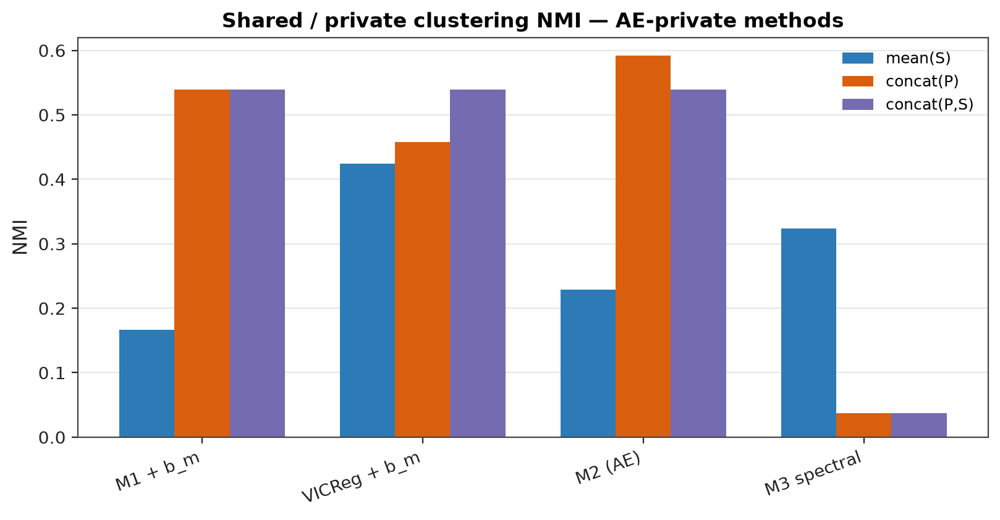
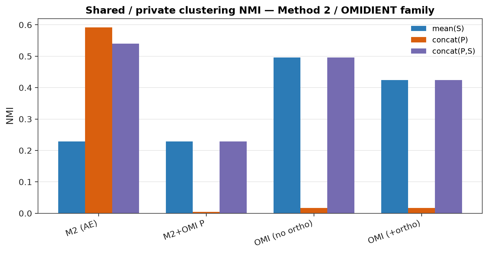
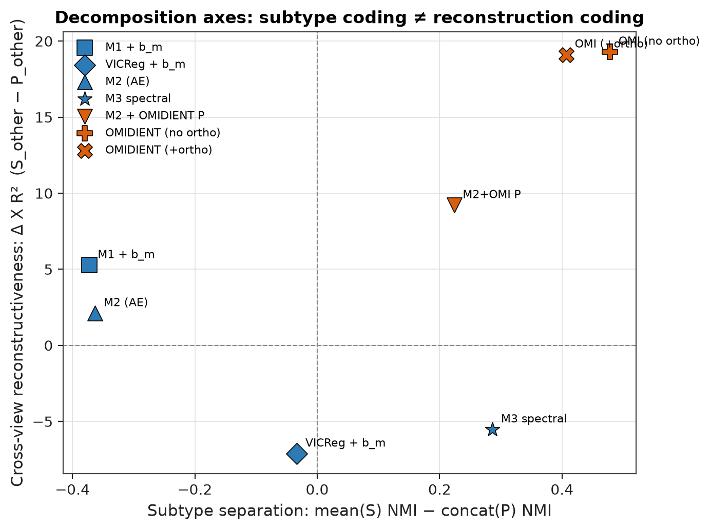
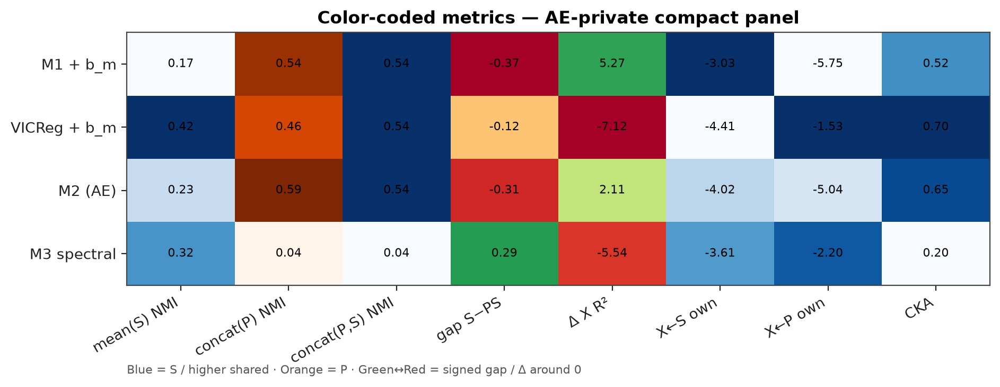
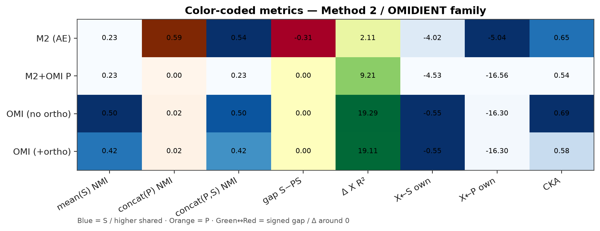
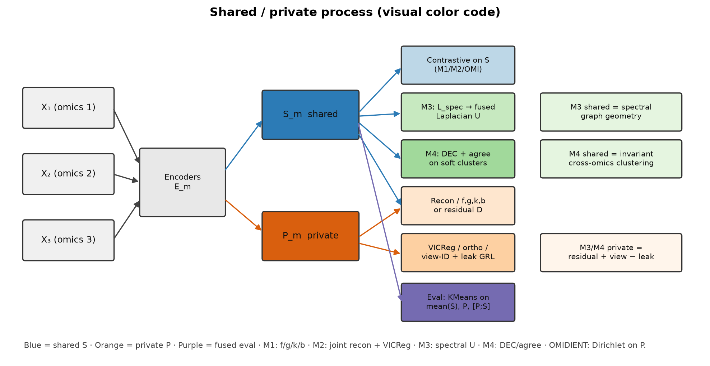

# Shared Representation Training Results — KIRC

Training and evaluation results for the methods in [`shared-representation-method.md`](./shared-representation-method.md), on **TCGA-KIRC** (289 samples; views ≈ 58k / 23k / 1.9k; **2** subtype classes via `class2`). BRCA counterpart: [`README.md`](./README.md).

**Single-seed sweeps:** all tables below are **seed 21**, data splits fixed (`random_state=1`). No KIRC multi-seed summary yet (BRCA uses `results/multiseed/`). Optimizer defaults for KIRC sweeps: `lr=2e-4`, `wd=7e-4` (MOCSS-kirc style) for Methods 1–3 / Method 2+OMIDIENT; OMIDIENT keeps fixed `lr=3e-4`, `wd=5e-4`, `K=4`.

**Not run on KIRC (yet):** Method 4 (invariant). **MOCSS (AE)** baseline: `sbatch run_mocss_kirc.slurm` → `results/models_kirc_ae/0.0002_0.0007/` (single published lr/wd). Compact AE panel currently lists M1 / VICReg / M2 / M3 until MOCSS finishes.

**Private branch:** Method 1, VICReg, Method 2 use **MOCSS-style plain AE** for `P_m`. OMIDIENT uses product-Dirichlet private. Method 2 + OMIDIENT mixes Method-2 shared with Dirichlet private.

**Ranking:** same as BRCA — core validation loss (label-free). Method 1 / VICReg → `L_std + L_shared + L_priv + L_ctr` (`L_vic` excluded for VICReg). Method 2 / Method 2+OMIDIENT → `L_recon + L_ctr`. Method 3 → `L_spec + L_res + L_ctr`. OMIDIENT λ-sweep → `L_ctr + L_recon + KL`.

**Note on Ridge R² (KIRC):** same probe as BRCA (Ridge α=1, same split). KIRC targets are ~58k-d, so without compression the regression is ill-posed; for width > 10k only we PCA \(Y\) to ≤50 comps (train-only) then score R² (`results/kirc_ridge_reeval.json`). **BRCA path is unchanged.** Absolute R² can still be largely negative — see Analysis. Prefer **Δ = R²(S)−R²(P)** for comparisons.

**Shared-quality metrics** (same suite as BRCA; `code/shared_rep_metrics.py`):

1. Clustering + kNN on `mean(S)` / `concat(P)` / `concat(P,S)`
2. Cross-view probes: subtype ← `S_other` (R² columns ignored on KIRC)
3. Alignment of shared codes: mean pairwise cosine / CCA / linear CKA

---

## Figures (visual color code)

Same color language as BRCA: blue = shared \(S\); orange = private \(P\); purple = concat \([P;S]\); green↔red = signed gaps.

| # | File | What it shows | Needs checkpoints? |
| - | ---- | ------------- | ------------------ |
| 1 | [`figures_kirc/01_nmi_bars_ae.png`](./figures_kirc/01_nmi_bars_ae.png), [`01_nmi_bars_omidient.png`](./figures_kirc/01_nmi_bars_omidient.png) | mean(S) / concat(P) / concat(P,S) NMI | No |
| 2 | [`figures_kirc/02_scatter_separation_vs_delta_xr2.png`](./figures_kirc/02_scatter_separation_vs_delta_xr2.png) | subtype sep vs Δ X R² (PCA-on-Y Ridge) | No |
| 3 | [`figures_kirc/03_metric_heatmap_ae.png`](./figures_kirc/03_metric_heatmap_ae.png), [`03_metric_heatmap_omidient.png`](./figures_kirc/03_metric_heatmap_omidient.png) | compact metrics | No |
| 4 | [`figures_kirc/04_method_schematic.png`](./figures_kirc/04_method_schematic.png) | process schematic | No |
| 5 | [`figures_kirc/05_embedding_umap.png`](./figures_kirc/05_embedding_umap.png) | UMAP/t-SNE of mean(S) vs concat(P) | Yes |
| 6 | [`figures_kirc/06_sweep_*.png`](./figures_kirc/) | hyperparameter heatmaps | Yes (leaderboard CSVs) |

**Regenerate figs 1–4 locally:**

```bash
cd /path/to/multiomics   # or set PYTHONPATH to parent of multiomics
python -m multiomics.code.viz.run_all --mode readme --disease kirc
# → docs/figures_kirc/
```

**Figs 5–6 on Triton** (needs models + leaderboards under `results/models_kirc_*`):

```bash
cd /scratch/work/soumir1/githubmultiomics/multiomics
sbatch run_viz_kirc.slurm
# or interactively:
export PYTHONPATH=/scratch/work/soumir1/githubmultiomics:${PYTHONPATH}
export MULTIOMICS_RESULTS=$PWD/results
python -m multiomics.code.viz.run_all --mode all --disease kirc --reduce umap
```

### Fig 1 — NMI bars





### Fig 2 — Separation vs Δ X R²



### Fig 3 — Color-coded metrics





### Fig 4 — Process schematic



### Fig 5–6 — embeddings & sweeps

Generate on Triton with `sbatch run_viz_kirc.slurm`. After that:

- `figures_kirc/05_embedding_umap.png` (or `05_embedding_tsne.png`)
- `figures_kirc/06_sweep_method1.png`, `06_sweep_method1_vicreg.png`, `06_sweep_method2.png`, `06_sweep_method3.png`, `06_sweep_method2_omidient.png`, `06_sweep_omidient_ortho.png`

---

## Compact comparison (AE private)

KIRC, single-seed loss winners. `gap S−PS` = mean(S) NMI − concat(P,S) NMI. `Δ X R²` / own-view = Ridge on PCA(Y) (see note above).

| Config | mean(S) NMI | concat(P) NMI | concat(P,S) NMI | gap S−PS | Δ X R² | X←S own | X←P own | X←[P;S] own | CKA |
| ------ | ---: | ---: | ---: | ---: | ---: | ---: | ---: | ---: | ---: |
| M1 + `b_m` loss-best (a1.5 b0.7 g1.0 p1.0) | 0.1670 | 0.5397 | 0.5397 | −0.3727 | 5.2667 | −3.0302 | −5.7540 | −9.3258 | 0.5163 |
| VICReg + `b_m` loss-best (a1.0 b0.5 v1.0 p1.0) | 0.4241 | 0.4574 | 0.5397 | −0.1156 | −7.1211 | −4.4135 | −1.5296 | −6.3479 | 0.7019 |
| M2 loss-best (r1.0 c0.7 v0.5) | 0.2286 | 0.5916 | 0.5397 | −0.3111 | 2.1092 | −4.0204 | −5.0438 | −8.0652 | 0.6499 |
| M3 spectral loss-best (s2 r1 c0) | 0.3236 | 0.0373 | 0.0373 | **+0.2863** | −5.5359 | −3.6087 | −2.2043 | −6.1630 | 0.2003 |

---

## Summary (best by eval_loss) — AE private

| Method | Best config | concat NMI | s_nmi | ARI | Acc | kNN | eval_loss |
| ------ | ----------- | ---: | ---: | ---: | ---: | ---: | ---: |
| Method 1 (+`b_m`) | `0.0002_0.0007_a1.5_b0.7_g1.0_p1.0_l1.0` | 0.5397 | 0.1670 | 0.6224 | 0.9138 | 1.00 | 1.4426 |
| Method 1 VICReg (+`b_m`) | `0.0002_0.0007_a1.0_b0.5_v1.0_p1.0_l1.0` | 0.5397 | 0.4241 | 0.6224 | 0.9138 | 1.00 | 1.3827 |
| Method 2 | `0.0002_0.0007_r1.0_c0.7_v0.5` | 0.5397 | 0.2286 | 0.6224 | 0.9138 | 1.00 | 0.6671 |
| Method 3 (spectral) | `0.0002_0.0007_s2.0_r1.0_c0.0_v0.1_vw0.5_lk0.5` | 0.0373 | 0.3236 | 0.0602 | 0.6552 | 1.00 | 0.3536 |

---

## Method 1 (4 networks) — with `b_m`

Package: `code/method1_predictability/`. Results: `results/models_kirc_method1/`. Rank: `eval_loss = L_std + L_shared + L_priv + L_ctr`.

### Top 10 by eval_loss

| Rank | Config | NMI | s_nmi | ARI | Acc | kNN | eval_loss |
| ---: | ------ | ---: | ---: | ---: | ---: | ---: | ---: |
| 1 | `0.0002_0.0007_a1.5_b0.7_g1.0_p1.0_l1.0` | 0.5397 | 0.1670 | 0.6224 | 0.9138 | 1.00 | 1.4426 |
| 2 | `0.0002_0.0007_a1.0_b2.0_g0.7_p0.3_l1.0` | 0.0982 | 0.2865 | −0.0927 | 0.5862 | 1.00 | 1.4432 |
| 3 | `0.0002_0.0007_a1.0_b0.7_g0.7_p1.0_l1.0` | 0.0211 | 0.1670 | −0.0606 | 0.6207 | 1.00 | 1.4439 |
| 4 | `0.0002_0.0007_a0.5_b0.7_g0.7_p1.0_l1.0` | 0.0211 | 0.1587 | −0.0606 | 0.6207 | 1.00 | 1.4441 |
| 5 | `0.0002_0.0007_a1.5_b0.7_g0.7_p0.5_l1.0` | 0.0870 | 0.2415 | −0.1033 | 0.6207 | 1.00 | 1.4496 |
| 6 | `0.0002_0.0007_a0.7_b0.7_g0.7_p1.0_l1.0` | 0.3684 | 0.2055 | 0.3779 | 0.8276 | 1.00 | 1.4511 |
| 7 | `0.0002_0.0007_a1.5_b0.5_g0.7_p1.0_l1.0` | 0.5397 | 0.3899 | 0.6224 | 0.9138 | 1.00 | 1.4520 |
| 8 | `0.0002_0.0007_a1.5_b0.5_g0.7_p0.5_l1.0` | 0.0816 | 0.5397 | −0.1070 | 0.6379 | 1.00 | 1.4530 |
| 9 | `0.0002_0.0007_a0.5_b1.0_g0.7_p0.5_l1.0` | 0.2865 | 0.2167 | 0.2383 | 0.7586 | 1.00 | 1.4543 |
| 10 | `0.0002_0.0007_a1.0_b1.5_g0.7_p1.0_l1.0` | 0.3236 | 0.2167 | 0.3032 | 0.7931 | 1.00 | 1.4546 |

**Best (eval_loss):** `0.0002_0.0007_a1.5_b0.7_g1.0_p1.0_l1.0` (α=1.5, β=0.7, γ=1.0, λ_priv=1.0, λ_ctr=1.0).

| | nmi | ari | f_score | acc | knn |
| --- | ---: | ---: | ---: | ---: | ---: |
| concat(P,S) | 0.5397 | 0.6224 | 0.8887 | 0.9138 | 1.00 |
| concat(P) | 0.5397 | 0.6224 | — | 0.9138 | 1.00 |
| mean(S) | 0.1670 | 0.0161 | — | 0.5862 | 1.00 |

Probes: subtype←S_other = 0.9556 | X←S R² = −11.4012 | X←P R² = −16.6679 | Δ(S−P) = 5.2667  
Own-view recon: X←S = −3.0302 | X←P = −5.7540 | X←[P;S] = −9.3258  
Alignment: cosine = 0.0387 | CCA = 1.0000 | CKA = 0.5163

---

## Method 1 VICReg ablation — with `b_m`

Package: `code/method1_vicreg_ablation/`. Results: `results/models_kirc_method1_vicreg/`. Rank: `eval_loss = L_std + L_shared + L_priv + L_ctr` (`L_vic` excluded).

### Top 10 by eval_loss

| Rank | Config | NMI | s_nmi | ARI | Acc | kNN | eval_loss |
| ---: | ------ | ---: | ---: | ---: | ---: | ---: | ---: |
| 1 | `0.0002_0.0007_a1.0_b0.5_v1.0_p1.0_l1.0` | 0.5397 | 0.4241 | 0.6224 | 0.9138 | 1.00 | 1.3827 |
| 2 | `0.0002_0.0007_a1.0_b0.7_v1.0_p1.0_l1.0` | 0.1432 | 0.5397 | −0.0265 | 0.5345 | 1.00 | 1.3854 |
| 3 | `0.0002_0.0007_a0.5_b0.5_v0.1_p1.0_l1.0` | 0.5916 | 0.4241 | 0.6846 | 0.9310 | 1.00 | 1.3861 |
| 4 | `0.0002_0.0007_a0.3_b0.5_v0.5_p1.0_l1.0` | 0.4956 | 0.3236 | 0.5654 | 0.8966 | 1.00 | 1.3866 |
| 5 | `0.0002_0.0007_a1.5_b0.5_v5.0_p1.0_l1.0` | 0.3947 | 0.2553 | 0.4195 | 0.8448 | 0.80 | 1.3877 |
| 6 | `0.0002_0.0007_a0.7_b0.5_v0.1_p1.0_l1.0` | 0.4956 | 0.3684 | 0.5654 | 0.8966 | 1.00 | 1.3878 |
| 7 | `0.0002_0.0007_a0.3_b0.5_v0.1_p1.0_l1.0` | 0.0211 | 0.2703 | −0.0606 | 0.6207 | 1.00 | 1.3885 |
| 8 | `0.0002_0.0007_a0.7_b0.5_v1.0_p1.0_l1.0` | 0.3236 | 0.3236 | 0.3032 | 0.7931 | 1.00 | 1.3890 |
| 9 | `0.0002_0.0007_a1.0_b0.5_v0.1_p1.0_l1.0` | 0.5397 | 0.4956 | 0.6224 | 0.9138 | 1.00 | 1.3890 |
| 10 | `0.0002_0.0007_a0.7_b0.5_v2.0_p0.5_l1.0` | 0.2865 | 0.3236 | 0.2383 | 0.7586 | 1.00 | 1.3908 |

**Best (eval_loss):** `0.0002_0.0007_a1.0_b0.5_v1.0_p1.0_l1.0` (α=1.0, β=0.5, λ_vic=1.0, λ_priv=1.0, λ_ctr=1.0).

| | nmi | ari | f_score | acc | knn |
| --- | ---: | ---: | ---: | ---: | ---: |
| concat(P,S) | 0.5397 | 0.6224 | 0.8887 | 0.9138 | 1.00 |
| concat(P) | 0.4574 | 0.5129 | — | 0.8793 | 1.00 |
| mean(S) | 0.4241 | 0.4644 | — | 0.8621 | 1.00 |

Probes: subtype←S_other = 1.0000 | X←S R² = −12.8306 | X←P R² = −5.7094 | Δ(S−P) = −7.1211  
Own-view recon: X←S = −4.4135 | X←P = −1.5296 | X←[P;S] = −6.3479  
Alignment: cosine = −0.0562 | CCA = 0.9999 | CKA = 0.7019

---

## Method 2 (joint recon + VICReg) — AE private

Package: `code/method2_joint_vicreg/`. Results: `results/models_kirc_method2/`. Rank: `eval_loss = L_recon + L_ctr`.

### Top 10 by eval_loss

| Rank | Config | NMI | s_nmi | ARI | Acc | kNN | eval_loss |
| ---: | ------ | ---: | ---: | ---: | ---: | ---: | ---: |
| 1 | `0.0002_0.0007_r1.0_c0.7_v0.5` | 0.5397 | 0.2286 | 0.6224 | 0.9138 | 1.00 | 0.6671 |
| 2 | `0.0002_0.0007_r1.5_c1.5_v1.0` | 0.5397 | 0.2055 | 0.6224 | 0.9138 | 1.00 | 0.6684 |
| 3 | `0.0002_0.0007_r1.0_c2.0_v0.1` | 0.0211 | 0.3042 | −0.0606 | 0.6207 | 0.93 | 0.6725 |
| 4 | `0.0002_0.0007_r0.7_c0.7_v0.5` | 0.5397 | 0.2553 | 0.6224 | 0.9138 | 1.00 | 0.6751 |
| 5 | `0.0002_0.0007_r1.0_c0.7_v2.0` | 0.4956 | 0.2415 | 0.5654 | 0.8966 | 1.00 | 0.6755 |
| 6 | `0.0002_0.0007_r0.7_c1.5_v1.0` | 0.4956 | 0.1851 | 0.5654 | 0.8966 | 1.00 | 0.6756 |
| 7 | `0.0002_0.0007_r0.7_c1.0_v0.5` | 0.5397 | 0.2167 | 0.6224 | 0.9138 | 1.00 | 0.6756 |
| 8 | `0.0002_0.0007_r0.7_c0.5_v1.0` | 0.4956 | 0.2415 | 0.5654 | 0.8966 | 1.00 | 0.6756 |
| 9 | `0.0002_0.0007_r1.0_c0.5_v1.0` | 0.4241 | 0.2553 | 0.4644 | 0.8621 | 1.00 | 0.6758 |
| 10 | `0.0002_0.0007_r1.0_c1.0_v0.5` | 0.5916 | 0.2553 | 0.6846 | 0.9310 | 1.00 | 0.6761 |

**Best (eval_loss):** `0.0002_0.0007_r1.0_c0.7_v0.5`.

| | nmi | ari | f_score | acc | knn |
| --- | ---: | ---: | ---: | ---: | ---: |
| concat(P,S) | 0.5397 | 0.6224 | 0.8887 | 0.9138 | 1.00 |
| concat(P) | 0.5916 | 0.6846 | — | 0.9310 | 1.00 |
| mean(S) | 0.2286 | 0.1318 | — | 0.6897 | 1.00 |

Probes: subtype←S_other = 1.0000 | X←S R² = −10.5279 | X←P R² = −12.6371 | Δ(S−P) = 2.1092  
Own-view recon: X←S = −4.0204 | X←P = −5.0438 | X←[P;S] = −8.0652  
Alignment: cosine = −0.0134 | CCA = 0.9999 | CKA = 0.6499

---

## Method 3 (spectral / graph shared)

Package: `code/method3_spectral_graph/`. Results: `results/models_kirc_method3/`. Rank: `eval_loss = L_spec + L_res + L_ctr`. Spectral ceiling on this run: `nmi_spectral_U = 0.1540`.

### Top 10 by eval_loss

| Rank | Config | NMI | s_nmi | ARI | Acc | kNN | eval_loss |
| ---: | ------ | ---: | ---: | ---: | ---: | ---: | ---: |
| 1 | `0.0002_0.0007_s2.0_r1.0_c0.0_v0.1_vw0.5_lk0.5` | 0.0373 | 0.3236 | 0.0602 | 0.6552 | 1.00 | 0.3536 |
| 2 | `0.0002_0.0007_s0.5_r1.0_c0.0_v0.1_vw0.5_lk0.5` | 0.2286 | 0.2167 | 0.1318 | 0.6897 | 1.00 | 0.3541 |
| 3 | `0.0002_0.0007_s1.5_r1.0_c0.0_v0.1_vw0.5_lk0.5` | 0.2703 | 0.2167 | 0.2090 | 0.7414 | 1.00 | 0.3547 |
| 4 | `0.0002_0.0007_s1.0_r1.0_c0.0_v0.1_vw0.5_lk0.5` | 0.3448 | 0.2286 | 0.3392 | 0.8103 | 1.00 | 0.3551 |
| 5 | `0.0002_0.0007_s0.5_r0.5_c0.0_v0.1_vw0.5_lk0.5` | 0.3448 | 0.2167 | 0.3392 | 0.8103 | 1.00 | 0.3584 |
| 6 | `0.0002_0.0007_s2.0_r0.5_c0.0_v0.1_vw0.5_lk0.5` | 0.3042 | 0.3042 | 0.2696 | 0.7759 | 1.00 | 0.3585 |
| 7 | `0.0002_0.0007_s1.0_r0.5_c0.0_v0.1_vw0.5_lk0.5` | 0.3947 | 0.2167 | 0.4195 | 0.8448 | 1.00 | 0.3587 |
| 8 | `0.0002_0.0007_s1.5_r0.5_c0.0_v0.1_vw0.5_lk0.5` | 0.3448 | 0.2286 | 0.3392 | 0.8103 | 1.00 | 0.3591 |
| 9 | `0.0002_0.0007_s0.5_r0.3_c0.0_v0.1_vw0.5_lk0.5` | 0.2415 | 0.1851 | 0.1559 | 0.7069 | 1.00 | 0.3605 |
| 10 | `0.0002_0.0007_s1.0_r0.3_c0.0_v0.1_vw0.5_lk0.5` | 0.0373 | 0.2415 | 0.0602 | 0.6552 | 1.00 | 0.3628 |

**Best (eval_loss):** `0.0002_0.0007_s2.0_r1.0_c0.0_v0.1_vw0.5_lk0.5`.

| | nmi | ari | f_score | acc | knn |
| --- | ---: | ---: | ---: | ---: | ---: |
| concat(P,S) | 0.0373 | 0.0602 | 0.6518 | 0.6552 | 1.00 |
| concat(P) | 0.0373 | 0.0602 | — | 0.6552 | 1.00 |
| mean(S) | 0.3236 | 0.3032 | — | 0.7931 | 1.00 |

Probes: subtype←S_other = 1.0000 | X←S R² = −12.6560 | X←P R² = −7.1201 | Δ(S−P) = −5.5359  
Own-view recon: X←S = −3.6087 | X←P = −2.2043 | X←[P;S] = −6.1630  
Alignment: cosine = 0.0513 | CCA = 1.0000 | CKA = 0.2003  
`nmi_spectral_U` = 0.1540

---

## Method 2 / OMIDIENT family

| Method | Best config | mean(S) NMI | concat(P) NMI | concat(P,S) NMI | Δ X R² | X←S own | X←P own | X←[P;S] own | CKA | eval_loss |
| ------ | ----------- | ---: | ---: | ---: | ---: | ---: | ---: | ---: | ---: | ---: |
| Method 2 (AE private) | `0.0002_0.0007_r1.0_c0.7_v0.5` | 0.2286 | 0.5916 | 0.5397 | 2.1092 | −4.0204 | −5.0438 | −8.0652 | 0.6499 | 0.6671 |
| Method 2 + OMIDIENT private | `0.0002_0.0007_r1.5_c0.5_v1.0_k4` | 0.2286 | 0.0049 | 0.2286 | 9.2089 | −4.5302 | −16.5603 | −22.8330 | 0.5428 | 0.6729 |
| OMIDIENT (no \(L_\mathrm{ortho}\)) | `0.0003_0.0005_4_c2_r1.5_k1` | 0.4956 | 0.0173 | 0.4956 | **19.2926** | −0.5494 | −16.2954 | −20.3786 | 0.6860 | 1.2738 |
| OMIDIENT (with \(L_\mathrm{ortho}\)) | `0.0003_0.0005_4_ortho_c2_r1.5_k0.5_o0.5` | 0.4241 | 0.0173 | 0.4241 | 19.1091 | −0.5528 | −16.2955 | −20.4081 | 0.5768 | 1.2715 |

### Method 2 + OMIDIENT private — top 10

Package: `code/method2_omidient_private/`. Results: `results/models_kirc_method2_omidient/`.

| Rank | Config | NMI | s_nmi | ARI | Acc | kNN | eval_loss |
| ---: | ------ | ---: | ---: | ---: | ---: | ---: | ---: |
| 1 | `0.0002_0.0007_r1.5_c0.5_v1.0_k4` | 0.2286 | 0.2286 | 0.1318 | 0.6897 | 1.00 | 0.6729 |
| 2 | `0.0002_0.0007_r0.7_c0.5_v1.0_k4` | 0.2415 | 0.2415 | 0.1559 | 0.7069 | 1.00 | 0.6776 |
| 3 | `0.0002_0.0007_r1.5_c0.5_v5.0_k4` | 0.5397 | 0.5397 | 0.6224 | 0.9138 | 1.00 | 0.6803 |
| 4 | `0.0002_0.0007_r1.5_c1.0_v1.0_k4` | 0.2865 | 0.2865 | 0.2383 | 0.7586 | 1.00 | 0.6829 |
| 5 | `0.0002_0.0007_r1.5_c0.5_v0.1_k4` | 0.3684 | 0.3684 | 0.3779 | 0.8276 | 1.00 | 0.6856 |
| 6 | `0.0002_0.0007_r0.7_c2.0_v5.0_k4` | 0.2703 | 0.2703 | 0.2090 | 0.7414 | 1.00 | 0.6863 |
| 7 | `0.0002_0.0007_r0.7_c1.0_v1.0_k4` | 0.2415 | 0.2415 | 0.1559 | 0.7069 | 0.93 | 0.6864 |
| 8 | `0.0002_0.0007_r0.7_c0.5_v5.0_k4` | 0.1507 | 0.1507 | −0.0133 | 0.5517 | 1.00 | 0.6877 |
| 9 | `0.0002_0.0007_r0.3_c0.5_v5.0_k4` | 0.1851 | 0.1851 | 0.0498 | 0.6207 | 1.00 | 0.6895 |
| 10 | `0.0002_0.0007_r0.3_c2.0_v5.0_k4` | 0.3684 | 0.3684 | 0.3779 | 0.8276 | 1.00 | 0.6904 |

**Best (eval_loss):** `0.0002_0.0007_r1.5_c0.5_v1.0_k4`.

| | nmi | ari | f_score | acc | knn |
| --- | ---: | ---: | ---: | ---: | ---: |
| concat(P,S) | 0.2286 | 0.1318 | 0.6675 | 0.6897 | 1.00 |
| concat(P) | 0.0049 | −0.0109 | — | 0.5000 | 0.93 |
| mean(S) | 0.2286 | 0.1318 | — | 0.6897 | 1.00 |

Probes: subtype←S_other = 1.0000 | X←S R² = −11.8955 | X←P R² = −21.1045 | Δ(S−P) = 9.2089  
Own-view recon: X←S = −4.5302 | X←P = −16.5603 | X←[P;S] = −22.8330  
Alignment: cosine = −0.0167 | CCA = 1.0000 | CKA = 0.5428

### OMIDIENT (no \(L_\mathrm{ortho}\)) — λ coarse grid

Package: `code/prod_gamma_dirvae/`. Results: `results/models_kirc_ProdGammaDirVae/`. Fixed lr/wd/K; coarse λ grid without ortho. Rank: `L_ctr + L_recon + KL`.

| Rank | Config | NMI | s_nmi | ARI | Acc | kNN | eval_loss |
| ---: | ------ | ---: | ---: | ---: | ---: | ---: | ---: |
| 1 | `0.0003_0.0005_4_c2_r1.5_k1` | 0.4956 | 0.4956 | 0.5654 | 0.8966 | 0.93 | 1.2738 |
| 2 | `0.0003_0.0005_4_c2_r1.5_k2` | 0.4956 | 0.4956 | 0.5654 | 0.8966 | 0.93 | 1.2739 |
| 3 | `0.0003_0.0005_4_c2_r1.5_k0.5` | 0.4956 | 0.4956 | 0.5654 | 0.8966 | 0.93 | 1.2752 |
| 4 | `0.0003_0.0005_4_c0.5_r0.3_k2` | 0.3684 | 0.3684 | 0.3779 | 0.8276 | 1.00 | 1.2814 |
| 5 | `0.0003_0.0005_4_c0.5_r0.3_k0.5` | 0.2286 | 0.2286 | 0.1318 | 0.6897 | 1.00 | 1.2865 |

**Best:** `0.0003_0.0005_4_c2_r1.5_k1` (λ_ctr=2.0, λ_recon=1.5, λ_kl=1.0).

| | nmi | ari | f_score | acc | knn |
| --- | ---: | ---: | ---: | ---: | ---: |
| concat(P,S) | 0.4956 | 0.5654 | 0.8676 | 0.8966 | 0.93 |
| concat(P) | 0.0173 | −0.0230 | — | 0.5172 | 0.93 |
| mean(S) | 0.4956 | 0.5654 | — | 0.8966 | 0.93 |

Probes: subtype←S_other = 1.0000 | X←S R² = −2.0606 | X←P R² = −21.3531 | Δ(S−P) = 19.2926  
Own-view recon: X←S = −0.5494 | X←P = −16.2954 | X←[P;S] = −20.3786  
Alignment: cosine = −0.1082 | CCA = 0.9204 | CKA = 0.6860

### OMIDIENT (with \(L_\mathrm{ortho}\)) — λ coarse grid

| Rank | Config | NMI | s_nmi | ARI | Acc | kNN | eval_loss |
| ---: | ------ | ---: | ---: | ---: | ---: | ---: | ---: |
| 1 | `0.0003_0.0005_4_ortho_c2_r1.5_k0.5_o0.5` | 0.4241 | 0.4241 | 0.4644 | 0.8621 | 1.00 | 1.2715 |
| 2 | `0.0003_0.0005_4_ortho_c1_r0.7_k0.5_o0.5` | 0.1161 | 0.1161 | −0.0698 | 0.5345 | 1.00 | 1.2773 |
| 3 | `0.0003_0.0005_4_ortho_c2_r1.5_k1_o0.5` | 0.4241 | 0.4241 | 0.4644 | 0.8621 | 0.87 | 1.2775 |
| 4 | `0.0003_0.0005_4_ortho_c2_r1.5_k0.5_o1` | 0.1291 | 0.1291 | −0.0500 | 0.5000 | 1.00 | 1.2800 |
| 5 | `0.0003_0.0005_4_ortho_c2_r1.5_k2_o1` | 0.0982 | 0.0982 | −0.0927 | 0.5862 | 0.93 | 1.2815 |

**Best:** `0.0003_0.0005_4_ortho_c2_r1.5_k0.5_o0.5` (λ_ctr=2.0, λ_recon=1.5, λ_kl=0.5, λ_ortho=0.5).

| | nmi | ari | f_score | acc | knn |
| --- | ---: | ---: | ---: | ---: | ---: |
| concat(P,S) | 0.4241 | 0.4644 | 0.8271 | 0.8621 | 1.00 |
| concat(P) | 0.0173 | −0.0230 | — | 0.5172 | 0.93 |
| mean(S) | 0.4241 | 0.4644 | — | 0.8621 | 1.00 |

Probes: subtype←S_other = 1.0000 | X←S R² = −2.2440 | X←P R² = −21.3531 | Δ(S−P) = 19.1091  
Own-view recon: X←S = −0.5528 | X←P = −16.2955 | X←[P;S] = −20.4081  
Alignment: cosine = −0.1205 | CCA = 0.9342 | CKA = 0.5768

---

## Analysis

Reading KIRC as a **2-class** shared/private problem (vs BRCA 5 subtypes). All numbers are single-seed (seed 21).

**AE-private methods collapse shared into private on the loss-best configs.**  
M1 / VICReg / M2 loss-winners all hit the same ceiling `concat(P,S) NMI ≈ 0.54` with **high `concat(P)`** (0.46–0.59) and much **weaker `mean(S)`** (0.17–0.42). Gap S−PS is largely negative (−0.12 to −0.37): private is carrying the subtype signal that integration uses. VICReg is the least bad AE-private hygiene (`s_nmi` 0.42, CKA 0.70, gap −0.12).

**Method 3 is the only AE-family method with S ≫ P.**  
Loss-best M3 has `mean(S) NMI = 0.32` vs `concat(P) ≈ 0.04` and gap **+0.29**, but `concat(P,S)` collapses to ~0.04 (private dilutes) and CKA is weak (0.20). Spectral ceiling is low (`nmi_spectral_U = 0.15`), so the shared graph target itself is limited on this KIRC labeling.

**Dirichlet private kills `concat(P)` NMI (as on BRCA) and shows the largest Δ X R².**  
M2+OMIDIENT / OMIDIENT rows have `concat(P) NMI ≈ 0.00–0.02` while `mean(S)` carries the clustering (0.23–0.50). PCA-on-Y Ridge: OMIDIENT Δ ≈ **+19** (S≪0 but P≪S), with own-view X←P ≈ −16; AE-private Δ is smaller / mixed (+5 M1, −7 VICReg, +2 M2, −5.5 M3). OMIDIENT no-ortho is also the strongest shared clustering (`s_nmi = ps_nmi = 0.50`, CKA 0.69).

**kNN = 1.00 is common** on this 2-class test split — treat it as a weak discriminator vs NMI/ARI/Acc.

**Next steps (optional):** MOCSS KIRC baseline for a fair AE-private reference; Method 4; multi-seed (n≥5) on the loss winners; PCA/standardize views before Ridge probes if R² diagnostics are needed.

---

## Artifact paths (Triton)

```text
results/models_kirc_method1/
results/models_kirc_method1_vicreg/
results/models_kirc_method2/
results/models_kirc_method2_omidient/
results/models_kirc_method3/
results/models_kirc_ProdGammaDirVae/
docs/figures_kirc/
```
